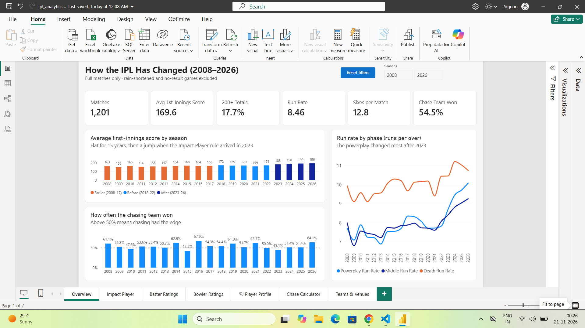
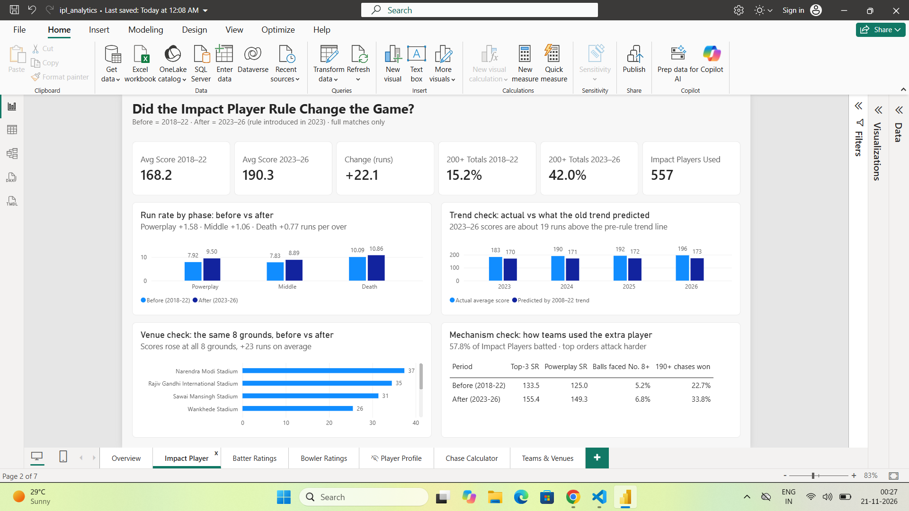
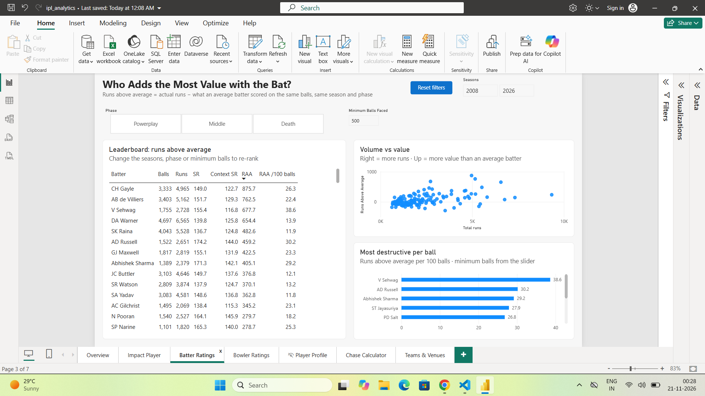
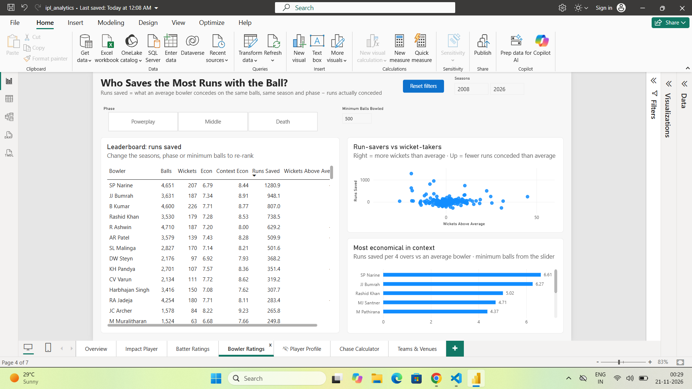
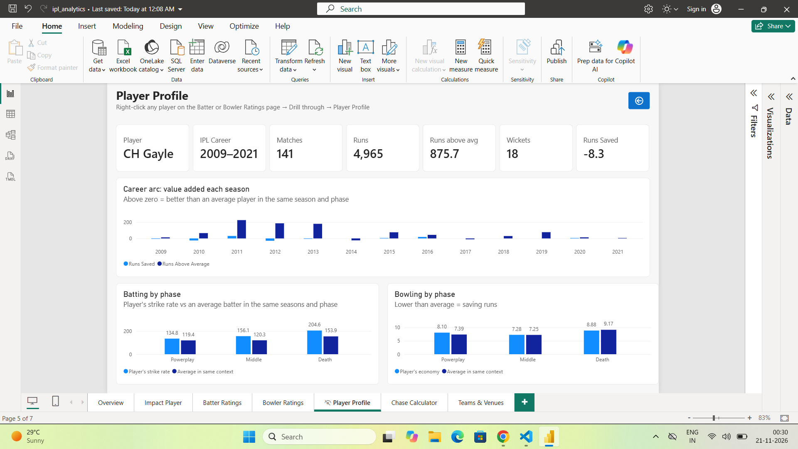
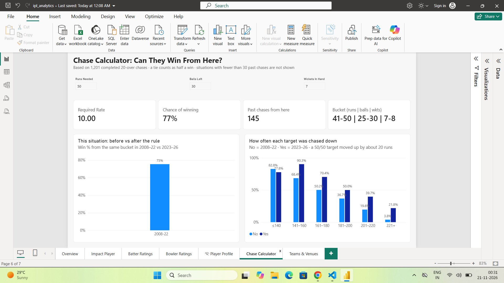
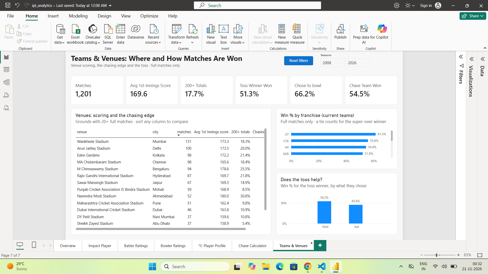
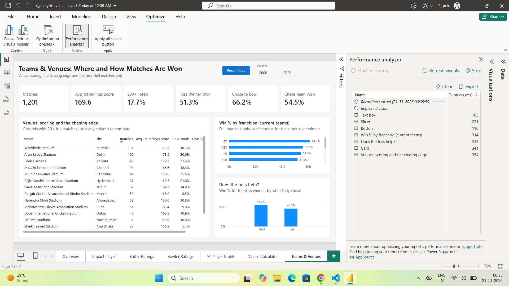
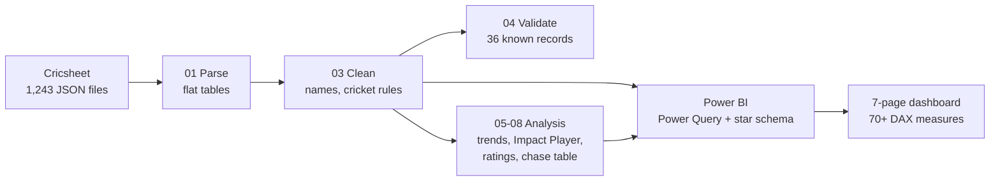
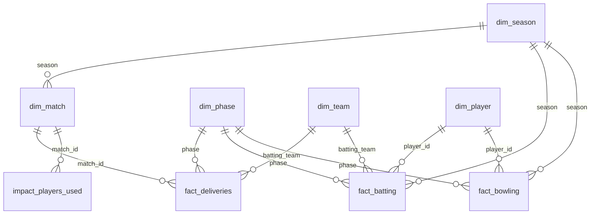

# IPL Analytics: What Actually Wins Matches

An end-to-end analytics project on **every IPL match from 2008 to 2026** (1,243 matches, ~295,000 deliveries):
Python data preparation, statistical analysis, and a **7-page interactive Power BI dashboard**.

It answers three questions most cricket dashboards don't:
1. **Did the Impact Player rule (2023) really change the game, or was scoring already rising?**
2. **Who adds the most value once you adjust for era and match phase?**
3. **How winnable is a chase from any situation, and has that changed?**

> Built for an IPL franchise's strategy team: auction staff, coaches and match-day analysts.

---

## Key results

| Finding | Number |
|---|---|
| Average first-innings score, 2018–22 → 2023–26 | **168 → 190 (+22 runs, +13%)** |
| First innings reaching 200+ | **15% → 42%** (52% in 2026) |
| Above the pre-rule trend line | **+19 to +27 runs**, and rising every season |
| Grounds where scores rose (same 8 grounds, both periods) | **8 of 8**, +23 runs on average |
| Biggest change by phase | **Powerplay +1.58 runs/over** (+20%) vs death +0.77 |
| Top-3 strike rate | **134 → 155** |
| Impact Player substitutions | **557** (~95% of possible), 58% of them batted |
| "200 is the new 170": 201–220 targets chased | **20% → 40%** |
| Most runs vs most value | Kohli **9,336 runs, +235** above average · Gayle 4,965 runs, **+876** |
| Best batting season on record (era-adjusted) | **V Suryavanshi 2026: +265** runs above average (SR 237) |
| Most runs saved | **Narine +1,281** · Bumrah saves **10.5 runs per 4 overs since 2023** |

**Verdict:** the rise breaks the earlier trend, appears at every common ground and comes with exactly the behaviour
the rule enables (aggressive top orders backed by deeper batting). The evidence strongly suggests the rule is a
major cause. It is observational data, so this is strong evidence, not proof (see [Limitations](#limitations)).

---

## Dashboard

### 1. Overview: how the IPL has changed


### 2. Impact Player: before vs after, with trend, venue and mechanism checks


### 3. Batter ratings: runs above average, adjusted for season and phase


### 4. Bowler ratings: runs saved and wickets above average


### 5. Player profile: drill-through from any player


### 6. Chase calculator: win % from any runs / balls / wickets situation


### 7. Teams & venues: venue scoring, the chasing edge and the toss


**Performance:** every visual loads in under 400 ms (Performance Analyzer).


---

## How it works



### Data model (star schema)



Standalone tables (no relationships): `chase_win_table`, `impact_trend_check`, `impact_venue_check`
and the what-if parameters.

---

## Data preparation highlights

| Quirk in the raw data | Fix |
|---|---|
| Season labels like "2007/08" and "2020/21" | Season = year of the match date |
| 19 team names for 15 franchises (Delhi Daredevils → Capitals, Kings XI → Punjab Kings, …) | Mapped to current names; Deccan Chargers and Sunrisers kept separate (different franchises) |
| 41 venue names for 36 grounds (Feroz Shah Kotla → Arun Jaitley, Motera → Narendra Modi, …) | Rename map, one city per ground |
| 51 matches with no city (Dubai, Sharjah) | Filled from the ground |
| Wides and no-balls in the over sequence | Legal-ball counter, matches the official scorers' ball numbers on all 295,557 balls |
| Super overs, rain-shortened and no-result games | Excluded where they would distort comparisons |

**Cricket rules applied:** a wide is not a ball faced · bowlers are charged wides and no-balls but not byes ·
run outs are not bowler wickets · phases: powerplay 1–6, middle 7–15, death 16–20.

**Validation:** all 36 Orange and Purple Caps from 2008 to 2025 reproduced exactly (e.g. Kohli 973 in 2016,
Bravo and Harshal Patel 32 wickets), plus Gayle 175*, SRH 287/3 and Alzarri Joseph 6/12. Every dashboard number
was checked against the Python results, and the cross-check caught one Python bug (wides counted in a numerator
but not its denominator), which was fixed.

---

## Methods

- **Impact Player test:** before (2018–22) vs after (2023–26) on full matches, plus three checks:
  a **trend check** (does 2023–26 beat the projected 2008–22 trend?), a **venue check** (the same grounds only)
  and a **mechanism check** (deeper batting, more aggressive top orders).
- **Runs above average (RAA):** for each ball, actual runs minus what an average batter scored per ball in the
  same season and phase. **Runs saved** is the bowling mirror. League totals sum to ~0 (a built-in check).
- **Chase table:** every legal ball of 1,201 completed chases, grouped into runs / balls / wickets buckets;
  win % shown only where a bucket has 30+ chases; a tie counts as half a win.

---

## Project structure

```
project4-ipl-analytics/
├── dashboard/
│   └── ipl_analytics.pbix        # Power BI report (7 pages)
├── data/
│   ├── raw/                      # Cricsheet JSON (downloaded, not committed)
│   ├── interim/                  # parsed tables
│   ├── clean/                    # cleaned tables
│   └── analysis/                 # analysis outputs used by Power BI
├── docs/
│   ├── project_design.md         # objective, questions, metric definitions
│   ├── data_preparation.md       # quirks, rules, checks
│   └── insights.md               # findings and recommendations
├── images/                       # dashboard screenshots
├── scripts/
│   ├── 00_explore_raw.py         # first look at the raw files
│   ├── 01_parse_raw.py           # JSON → flat tables
│   ├── 02_check_quirks.py        # find naming and data quirks
│   ├── 03_clean.py               # apply fixes and cricket rules, run checks
│   ├── 04_validate.py            # reproduce known IPL records
│   ├── 05_season_trends.py       # season-by-season trends
│   ├── 06_impact_player.py       # Impact Player test (trend, venue, mechanism)
│   ├── 07_player_ratings.py      # runs above average, runs saved
│   └── 08_chase_table.py         # chase win-probability table
├── requirements.txt
└── README.md
```

| Document | What's in it |
|---|---|
| [Project design](docs/project_design.md) | Objective, stakeholders, 10 business questions, metric definitions, analysis design |
| [Data preparation](docs/data_preparation.md) | Every quirk found and how it was fixed, plus the validation checks |
| [Insights](docs/insights.md) | Full findings, recommendations and limitations |

---

## How to run

**1. Get the data**
Download the IPL JSON files from [Cricsheet](https://cricsheet.org/downloads/) and extract them into
`data/raw/ipl_json/`.

**2. Run the Python pipeline** (Python 3.12)
```bash
python -m venv .venv
.venv\Scripts\activate
python -m pip install -r requirements.txt
python scripts/01_parse_raw.py
python scripts/03_clean.py
python scripts/04_validate.py
python scripts/05_season_trends.py
python scripts/06_impact_player.py
python scripts/07_player_ratings.py
python scripts/08_chase_table.py
```

**3. Open the dashboard**
Open `dashboard/ipl_analytics.pbix` in Power BI Desktop → **Transform data → Manage parameters** →
set **ProjectFolder** to your project path (ending in `\`) → **Close & Apply**.

---

## Tools

**Python** (pandas) · **Power BI** (Power Query, star-schema modelling, DAX, what-if parameters, drill-through,
Performance Analyzer) · **VS Code**

---

## Limitations

- Free public data (Cricsheet): no ball-tracking, fielding positions or auction prices.
- Only 4 seasons after the rule, and other changes happened at the same time (e.g. two bouncers per over from 2024).
  A control group (T20 leagues without the rule over the same years) would strengthen the conclusion.
- Runs above average measures scoring rate in context; it does not count the cost of dismissals, match situation,
  opposition or ground. MS Dhoni rates slightly below average, which misses his value as a finisher.
- Chase win % applies to a bucket of situations, not an exact score.

---

## Data source

Ball-by-ball data from [Cricsheet](https://cricsheet.org), used under its open data licence
(see the LICENSE file included with the download).

## Author

**Naman Rajyagor** · [LinkedIn](https://www.linkedin.com/in/naman-rajyagor-51828228b)